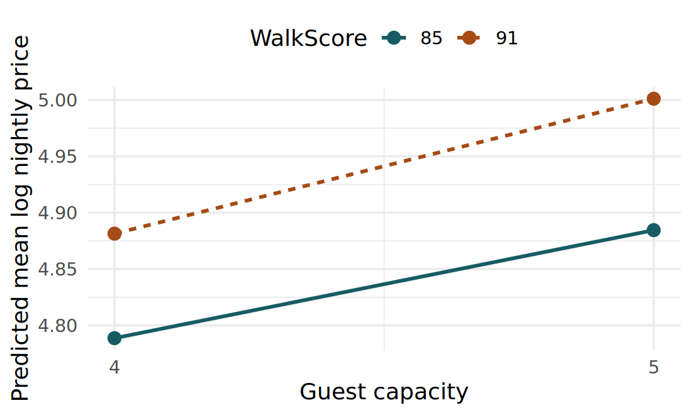

# Guest capacity and nightly price

We study the same 826 entire-home listings in 36 Chicago neighborhoods as in Lab 5. The outcome is the natural logarithm of the listed price in dollars per night. Guest capacity is the number of people a home can accommodate.

Lab 5 estimated the difference in expected log nightly price associated with one additional guest place. The model assumed the same capacity slope in every neighborhood. WalkScore shifted the fitted lines up or down, and the lines were parallel.

Here we allow each neighborhood to have its own capacity slope. We estimate how much the slopes vary across neighborhoods and ask whether they tend to be steeper in more walkable neighborhoods.

# Setup and data

Save your script as `lab6.R` in the `week3` folder and set that folder as your working directory. Save the [Chicago Airbnb data](data/airbnb.csv) as `data/airbnb.csv` inside `week3`. Install the packages with `pak` if needed, as in [Lab 1](BLR_lab_center_fixed.html#install-pak-once).

```{r}
#| label: setup
library(pak)
pkg_install(c("dplyr", "ggplot2", "lmerTest", "emmeans"))
```

```{r}
#| label: read-listings
library(dplyr)
library(ggplot2)
library(lmerTest)

airbnb <- read.csv("data/airbnb.csv")
airbnb <- filter(airbnb, room_type == "Entire home/apt")
airbnb$neighborhood <- factor(airbnb$neighborhood)
airbnb$log_price <- log(airbnb$price)
airbnb$capacity_c <- airbnb$accommodates - 4
airbnb$walk10 <- (airbnb$WalkScore - 80) / 10
```

A four-guest home has `capacity_c = 0`, and a five-guest home has `capacity_c = 1`. A neighborhood with WalkScore 80 has `walk10 = 0`. Each additional ten WalkScore points increases `walk10` by one.

```{=latex}
\clearpage
```
# Plot log nightly price against guest capacity

The six neighborhoods with the most entire-home listings each have their own panel. All six panels use the same axis scales, so a steeper line indicates a larger difference in log price per additional guest place.

```{r}
#| label: capacity-by-neighborhood
top_six <- count(airbnb, neighborhood, sort = TRUE) |>
  slice_head(n = 6)

homes <- filter(airbnb, neighborhood %in% top_six$neighborhood)

ggplot(homes, aes(accommodates, log_price)) +
  geom_point(position = position_jitter(width = 0.12, height = 0, seed = 6),
             alpha = 0.35, color = "#173F48") +
  geom_smooth(method = "lm", formula = y ~ x, se = FALSE, color = "#C57722") +
  facet_wrap(~ neighborhood, ncol = 3) +
  labs(x = "Guest capacity", y = "Log nightly price") +
  theme_minimal(base_size = 13)
```

Each dot represents a listing. Homes with the same capacity are spread slightly apart on the horizontal axis so that individual listings are easier to see. The fitted line in each panel comes from a separate regression using the original guest capacities.

::: {.callout-important icon=false title="Question 1"}
Compare Humboldt Park and Rogers Park. In which neighborhood does log nightly price rise more steeply with guest capacity? Looking across all six fitted lines, does a common capacity slope seem reasonable? Explain your judgment.
:::

```{=latex}
\clearpage
```
# Fit a random intercept and a random capacity slope

The fitted lines suggest that an additional guest place is associated with a larger difference in log nightly price in some neighborhoods than in others. A random capacity slope lets us estimate how much the slopes vary. As in Lab 5, the model includes WalkScore and a random neighborhood intercept.

$$
L_{ij}=(\beta_0+c_j)+(\beta_1+b_j)C_{ij}
       +\beta_2 W_j+\varepsilon_{ij}.
$$

For listing $i$ in neighborhood $j$, $L_{ij}$ is log nightly price and $C_{ij}$ is centered guest capacity. $W_j$ is the centered and rescaled WalkScore. For a four-guest home, $c_j$ is the amount by which the neighborhood mean log price differs from the mean predicted by WalkScore. The capacity slope in that neighborhood is $\beta_1+b_j$, where $\beta_1$ is the average slope and $b_j$ is the neighborhood’s deviation from that average.

```{r}
#| label: random-capacity-slope
model_slope <- lmer(log_price ~ capacity_c + walk10 +
                      (1 + capacity_c | neighborhood), data = airbnb)
summary(model_slope)
```

We can judge the size of the differences between neighborhood slopes by comparing their standard deviation (SD) with the average slope. The standard deviation is the square root of the slope variance, so both the SD and the average slope are in log-price units per additional guest place. In the `capacity_c` row, read the average slope under **Fixed effects** and the SD under **Random effects** (`Std.Dev.`).

::: {.callout-important icon=false title="Question 2"}
Report the estimated average capacity slope and its standard error. On average across neighborhoods, how much higher or lower is the expected log nightly price for a five-guest home than for a four-guest home in the same neighborhood?
:::

::: {.callout-important icon=false title="Question 3"}
Under the model’s Normal distribution, what range contains the middle 68% of neighborhood capacity slopes? Use this range to explain how much the association between guest capacity and nightly price varies across neighborhoods.
:::

::: {.callout-important icon=false title="Question 4"}
Read the intercept–slope correlation from the `Corr` column under **Random effects**. After accounting for WalkScore, do neighborhoods with higher expected log prices for four-guest homes tend to have steeper or flatter capacity slopes? Interpret the sign and magnitude of the estimate.
:::

```{=latex}
\clearpage
```
# Add the interaction between capacity and WalkScore

In the random-slope model, individual neighborhoods have their own capacity slopes. At every WalkScore, those slopes vary around the same average, $\beta_1$. Adding $\beta_3 C_{ij}W_j$ lets us ask whether the average difference in log price between a five-guest and a four-guest home changes with neighborhood walkability. This is a **cross-level interaction** because capacity describes a listing and WalkScore describes its neighborhood. The full model for log nightly price is

$$
L_{ij}=(\beta_0+c_j)+(\beta_1+b_j)C_{ij}
       +\beta_2 W_j+\beta_3 C_{ij}W_j+\varepsilon_{ij}.
$$

Collecting the terms that multiply $C_{ij}$ gives the capacity slope in neighborhood $j$, $\beta_1+b_j+\beta_3 W_j$. At WalkScore 80, $W_j=0$ and the average slope is $\beta_1$. At WalkScore 90, $W_j=1$ and the average slope is $\beta_1+\beta_3$. The neighborhood deviation $b_j$ tells us how far a particular slope lies above or below the average at that WalkScore.

```{r}
#| label: capacity-walk-interaction
model_interaction <- lmer(
  log_price ~ capacity_c + walk10 + capacity_c:walk10 +
    (1 + capacity_c | neighborhood),
  data = airbnb
)
summary(model_interaction)
```

::: {.callout-important icon=false title="Question 5"}
Report the p-value for `capacity_c:walk10` under **Fixed effects**. Is the interaction between guest capacity and WalkScore statistically significant at the 5% level?
:::

Under **Random effects**, the `capacity_c` variance now describes how much neighborhood slopes vary around the average slope at their WalkScore.

::: {.callout-important icon=false title="Question 6"}
Compare the `capacity_c` variances in the two model summaries. By what percentage does the estimated slope variance decrease when the interaction is added? Interpret the remaining variance in terms of neighborhood capacity slopes.
:::

```{=latex}
\clearpage
```

# Compare four-guest and five-guest homes at two WalkScores

The significant interaction indicates that the association between guest capacity and log nightly price depends on neighborhood walkability. We interpret the interaction by examining the **simple effects of guest capacity**. At a given WalkScore, the simple effect is the difference in expected log nightly price between a five-guest home and a four-guest home.

We want to see how large this price gap is in less walkable and more walkable neighborhoods. We therefore estimate it at the lower and upper quartiles of WalkScore among the listings.

```{r}
#| label: listing-walkscore-quartiles
quantile(airbnb$WalkScore, c(0.25, 0.75))
```

## Estimate mean log nightly prices

A **reference grid** lists the combinations of predictor values at which `emmeans()` makes predictions from the fitted model. Guest capacity and WalkScore are both numerical predictors in this model. By default, `emmeans()` sets each of them to its sample mean, so the grid contains just one combination and gives us one estimated mean log nightly price.

For the simple effect at WalkScore 85, we need a fitted mean for four-guest homes and another for five-guest homes. We need the same pair at WalkScore 91. We use `at` to supply the two values of each predictor on the scales used to fit the model. This gives us all four combinations.

- `capacity_c = c(4, 5) - 4` requests centered capacities 0 and 1, representing homes for four and five guests.
- `walk10 = (c(85, 91) - 80) / 10` requests 0.5 and 1.1 on the model scale, representing WalkScores 85 and 91.

In `~ capacity_c | walk10`, the vertical bar groups the fitted means by WalkScore. These fitted means use the fixed effects and describe the expected log price averaged over neighborhoods at the specified WalkScore. Setting `lmer.df = "satterthwaite"` uses the same degrees-of-freedom method as the model summary.

```{r}
#| label: capacity-means
library(emmeans)
capacity_means <- emmeans(
  model_interaction, ~ capacity_c | walk10,
  at = list(capacity_c = c(4, 5) - 4, walk10 = (c(85, 91) - 80) / 10),
  lmer.df = "satterthwaite"
)
print(capacity_means, digits = 4)
```

::: {.callout-important icon=false title="Question 7"}
Which row in the `emmeans` output represents a five-guest home at WalkScore 85? Report its estimated mean log nightly price from the `emmean` column.
:::

## Compare the capacity contrasts

We plot the four fitted means to compare the simple effects of guest capacity at WalkScores 85 and 91. We join the four-guest and five-guest means at each WalkScore. The vertical change from the first point to the second gives the estimated difference in mean log nightly price at that WalkScore.

```{r}
#| label: fitted-capacity-slopes
plot_means <- as.data.frame(capacity_means)
plot_means$guests <- plot_means$capacity_c + 4
plot_means$WalkScore <- factor(80 + 10 * plot_means$walk10)

ggplot(plot_means, aes(guests, emmean, color = WalkScore, linetype = WalkScore)) +
  geom_line(linewidth = 1) +
  geom_point(size = 3) +
  scale_x_continuous(breaks = c(4, 5)) +
  scale_color_manual(values = c("#175C65", "#A54B16")) +
  labs(x = "Guest capacity", y = "Predicted mean log nightly price") +
  theme_minimal(base_size = 13) +
  theme(legend.position = "top")
```

{fig-alt="Five-guest homes have higher fitted mean log prices than four-guest homes at both WalkScores. The gap between capacities is larger at WalkScore 91 than at 85." width=80%}

At each WalkScore, `pairs()` with `reverse = TRUE` subtracts the four-guest mean from the five-guest mean. The `estimate` column reports that simple effect in log-price units.

```{r}
#| label: capacity-contrasts
capacity_effects <- pairs(capacity_means, reverse = TRUE)
print(capacity_effects)
```

::: {.callout-important icon=false title="Question 8"}
Report the estimated difference in mean log nightly price between five-guest and four-guest homes at each WalkScore. How much larger or smaller is this gap at 91 than at 85?
:::
