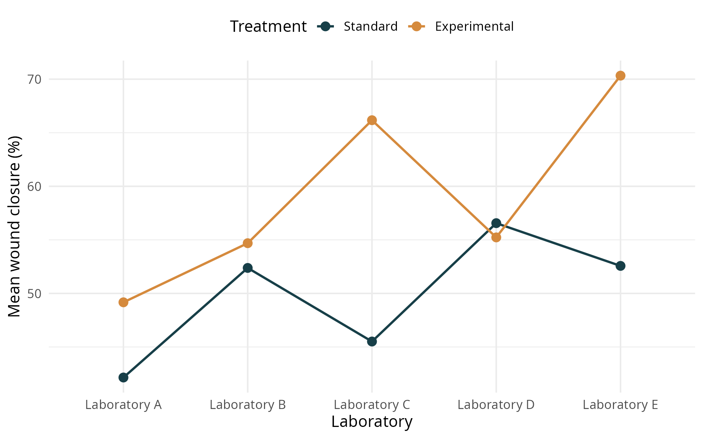

# The wound-healing experiment revisited

In [Lab 3](BLR_lab_fixed_interaction.html), five laboratories compared a standard treatment with an experimental treatment. Each laboratory randomly assigned 10 independent cell-culture plates to each treatment. The outcome was the percentage of the original wound area that had closed after 48 hours. Each plate was measured once, giving 100 observations. These are simulated teaching data.

The interaction plot below recalls the observed treatment means from Lab 3. Each line represents one treatment, and the vertical gap between the lines is the observed treatment difference in a laboratory.

{fig-alt="Interaction plot with laboratories A to E on the horizontal axis and mean wound closure on the vertical axis. The experimental-minus-standard difference varies across laboratories." width=75% fig-pos="H"}

We now regard these laboratories as representing a wider population of laboratories using the same experimental protocol. Our question is: **What is the average treatment effect across that population, and how much do treatment effects vary between laboratories?** Generalizing in this way relies on the laboratories being relevant to the population of interest.

By the end of this lab, you should be able to fit a random-intercept and treatment-slope model, interpret its variance components and intercept-slope correlation, interpret the population-average treatment effect and its uncertainty, and assess the conditional residuals.

::: {.callout-note icon=false title="Working through the lab"}
Run the code in order in an R script and record your answers to the questions. As in the earlier labs, the page supplies analysis code and you generate the results yourself. The plot above is provided as background from Lab 3.
:::

# Setup and data

Save your script as `lab4.R` in your `week2` folder and set that folder as your working directory. Use the same [wound-healing dataset](data/wound_healing_week2.csv) as in Lab 3, saved in the `data` subfolder. The code below also works in a new R session.

We use `lme4` and `lmerTest`, as in Lab 2. `lmerTest` adds approximate degrees of freedom and tests for the fixed effects. We also use `emmeans`, introduced in Lab 3, to estimate the population-average treatment effect and its uncertainty. Install the packages with `pak` if needed, following [Lab 1](BLR_lab_center_fixed.html#install-pak-once). If prompted, confirm the installation and wait for it to finish.

```{r}
#| label: setup
library(pak)
pkg_install(c("lme4", "lmerTest", "emmeans"))

library(lme4)
library(lmerTest)
library(emmeans)
```

Read the data, specify the factor levels, and set dummy coding for treatment explicitly. Standard treatment is the reference category.

```{r}
#| label: read-data
wound <- read.csv("data/wound_healing_week2.csv")
wound$treatment <- factor(wound$treatment,
                           levels = c("Standard", "Experimental"))
wound$laboratory <- factor(wound$laboratory)
contrasts(wound$treatment) <- contr.treatment(levels(wound$treatment))
```

Each row is one plate. `closure` is wound closure as a percentage, `treatment` identifies the assigned treatment, and `laboratory` identifies the laboratory. Treatment differences are expressed in **percentage points**.

# Specify and fit the model

## Allow both the intercept and treatment effect to vary

Let $Y_{ij}$ be the closure for plate $i$ in laboratory $j$, with $T_{ij}=0$ for standard treatment and $T_{ij}=1$ for experimental treatment. We specify

$$
Y_{ij}=\beta_0+c_j+(\beta_1+d_j)T_{ij}+\varepsilon_{ij}.
$$

- $\beta_0$ is the standard-treatment mean averaged over the population of laboratories.
- $\beta_1$ is the experimental-minus-standard effect averaged over that population.
- $c_j$ is laboratory $j$'s deviation from the population standard-treatment mean.
- $d_j$ is laboratory $j$'s deviation from the population-average treatment effect.
- $\varepsilon_{ij}$ is the remaining individual plate error.

Thus, laboratory $j$ has intercept $\beta_0+c_j$ and treatment effect $\beta_1+d_j$. The treatment effect is called a **slope** because it describes the change in expected closure when treatment changes from 0 (standard) to 1 (experimental).

The laboratory deviations follow a joint Normal distribution:

$$
\begin{pmatrix}c_j\\d_j\end{pmatrix}
\sim N\!\left[
\begin{pmatrix}0\\0\end{pmatrix},
\begin{pmatrix}\sigma_c^2&\sigma_{cd}\\\sigma_{cd}&\sigma_d^2\end{pmatrix}
\right].
$$

The diagonal entries describe variation in standard-treatment means and in treatment effects. The off-diagonal entry, $\sigma_{cd}$, is their covariance. We allow the two deviations within a laboratory to be correlated. Deviation pairs are independent across laboratories.

Individual errors are independent Normal variables with a common variance,

$$
\varepsilon_{ij}\overset{\mathrm{iid}}{\sim}N(0,\sigma^2),
$$

and are independent of the laboratory deviations.

::: {.callout-important icon=false title="Question 1"}
What do a positive $c_j$ and a positive $d_j$ mean in this experiment? What is the expected closure under each treatment in laboratory $j$? Identify the term that allows treatment effects to vary between laboratories.
:::

## Fit the random-intercept and slope model

```{r}
#| label: random-slope-model
model_random <- lmer(
  closure ~ treatment + (1 + treatment | laboratory),
  data = wound,
  REML = TRUE
)
summary(model_random)
```

The formula has two parts:

- `closure ~ treatment` specifies the population-average intercept and treatment effect.
- `(1 + treatment | laboratory)` adds a laboratory-specific random intercept and random treatment slope, allowing them to be correlated.

Laboratory is the grouping variable. We use restricted maximum likelihood (REML) to estimate the variance components, as in Lab 2.

The summary separates the **fixed effects**, which describe the population averages, from the **random effects**, which describe variation around those averages. In the fixed-effect table, `(Intercept)` estimates $\beta_0$ and `treatmentExperimental` estimates $\beta_1$.

::: {.callout-note icon=false title="The intercept is included by default"}
The `1` denotes an intercept and is included by default: `(treatment | laboratory)` is equivalent to `(1 + treatment | laboratory)`. Both specify a random intercept and treatment slope, allowing them to be correlated. We write `1 + treatment` here to make both components visible. Similarly, the fixed-effects formula `closure ~ treatment` already includes an intercept.
:::

::: {.callout-important icon=false title="Question 2"}
Identify and interpret the estimated population-average standard-treatment mean and the estimated population-average treatment effect. How is the treatment effect in a particular laboratory represented in the model?
:::

```{=latex}
\clearpage
```

# Interpret the variance components

## Display the variance components

Use `VarCorr()` to display the estimated variance components and intercept-slope correlation. Setting `comp = "Variance"` displays the variances; the default displays standard deviations.

```{r}
#| label: variance-components
print(VarCorr(model_random), comp = "Variance")
```

```{=latex}
\Needspace{15\baselineskip}
```

The three variances have units of squared percentage points with treatment coded 0/1. The `Corr` column gives the intercept-slope correlation.

| Component | Interpretation |
| --- | --- |
| Intercept variance, $\sigma_c^2$ | Variation in standard-treatment means between laboratories |
| Treatment-slope variance, $\sigma_d^2$ | Variation in treatment effects between laboratories |
| Residual variance, $\sigma^2$ | Variation among individual plates around their laboratory-specific treatment mean |

```{=latex}
\Needspace{23\baselineskip}
```

## Interpret the intercept-slope correlation

The intercept-slope covariance describes how laboratory deviations in standard-treatment means and treatment effects vary together. The correlation expresses this relationship on a standardized scale by dividing the covariance by the product of the two standard deviations:

$$
\widehat{\rho}_{cd}
=\frac{\widehat{\sigma}_{cd}}
{\sqrt{\widehat{\sigma}_c^2\widehat{\sigma}_d^2}}.
$$

R provides this estimated correlation in the `Corr` column of the `VarCorr()` output above.

The intercept-slope correlation describes the relationship between **laboratory deviations** in standard-treatment means and treatment effects. A positive correlation means that laboratories with higher standard-treatment means tend to have larger treatment effects. A negative correlation means that they tend to have smaller treatment effects.

::: {.callout-important icon=false title="Question 3"}
Identify the estimated intercept variance, treatment-slope variance and residual variance. Which source has the largest estimated variance? Identify the estimated intercept-slope correlation in the output and interpret its sign in the wound-healing setting.
:::

```{=latex}
\clearpage
```

# Estimate the population-average treatment effect

The treatment coefficient describes an average across the population of laboratories. Its **estimated standard error** describes uncertainty about that average. The treatment-slope variance describes how much the effects themselves vary between laboratories.

We use estimated marginal means to estimate the population-average mean under each treatment. Comparing these means gives the population-average treatment effect, with its estimated standard error, 95% confidence interval and p-value.

```{r}
#| label: treatment-confidence-interval
treatment_means <- emmeans(
  model_random, ~ treatment, lmer.df = "satterthwaite"
)
treatment_effect <- pairs(treatment_means, reverse = TRUE, adjust = "none")
summary(treatment_effect, infer = c(TRUE, TRUE))
```

Here, `~ treatment` requests population-average treatment means. As in Lab 3, `reverse = TRUE` gives experimental minus standard, and `infer = c(TRUE, TRUE)` includes both confidence intervals and tests. The p-value tests whether the population-average treatment effect is zero.

We specify `lmer.df = "satterthwaite"` to match the method used in the `lmerTest` model summary. For these models, `emmeans` uses Kenward–Roger by default when available.

The estimate, estimated SE and confidence limits are in percentage points. The confidence interval expresses uncertainty about the **population-average treatment effect**.

::: {.callout-important icon=false title="Question 4"}
Report the population-average treatment estimate, its estimated SE, 95% confidence interval and p-value. Is a zero population-average effect compatible with the interval? Explain the difference between uncertainty about the average treatment effect and variation in treatment effects between laboratories.
:::

```{=latex}
\clearpage
```

# Examine the residual diagnostics

Conditional fitted values include the population-average coefficients and the estimated laboratory contributions to both the intercept and treatment slope. The **conditional residuals** are observed plate outcomes minus these fitted values. They help assess the individual-error assumptions.

```{=latex}
\Needspace{18\baselineskip}
```

```{r}
#| label: random-slope-diagnostics
conditional_residuals <- resid(model_random)
conditional_fitted <- fitted(model_random)

plot(conditional_fitted, conditional_residuals,
     xlab = "Conditional fitted wound closure (%)",
     ylab = "Conditional residual (percentage points)")
abline(h = 0, lty = 2, col = "grey50")

qqnorm(conditional_residuals,
       main = "Normal Q-Q plot of conditional residuals")
qqline(conditional_residuals, col = "grey50")
```

The residual-versus-fitted plot can reveal patterns or changing spread. The Q-Q plot helps assess Normality of the individual errors.

::: {.callout-important icon=false title="Question 5"}
Explain what the conditional residuals represent. What do the two plots suggest about constant variance and Normality of the individual errors? Support your interpretations with features of the plots.
:::
